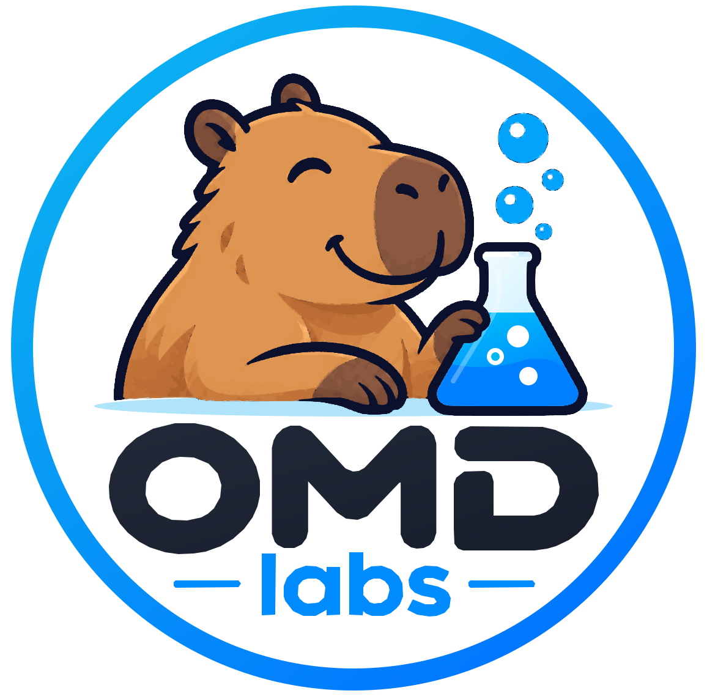

  <a href="https://omd.consol.de/docs/omd/">
    <picture>
      <source media="(prefers-color-scheme: dark)" srcset=".github/assets/omd-labs-logo-dark.svg">
      <source media="(prefers-color-scheme: light)" srcset=".github/assets/omd-labs-logo-light.svg">
      
    </picture>
  </a>

<h1 align="center">OMD-Labs - the Open Monitoring Distribution (Labs Edition)</h1>

  <a href="https://omd.consol.de/docs/omd/">Documentation</a> ·
  <a href="https://omd.consol.de/docs/omd/getting_started/">Getting started</a> ·
  <a href="https://omd.consol.de/docs/omd/packages/">Packages</a>

OMD-Labs is based on OMD with some additional software packages
and best practices applied.

## What OMD-Labs contains in addition

  * SSL Webserver
  * Grafana
  * Prometheus
  * Influxdb
  * Icinga 2
  * Naemon
  * Livestatus for Naemon
  * Mod-Gearman for Naemon
  * PNP for Naemon
  * Best Practices:
    - Thruk
      - set as default gui
      - autostart enabled
      - enable cookie authentication
    - Naemon
      - enabled by default

The full list of included packages can be found [here](https://omd.consol.de/docs/omd/packages/).

## Licensing

OMD-Labs is available under the terms of the GNU General Public License of version 2. You find those terms in the file LICENSE.

Please note, that that license only applies to OMD itself (its scripts, patches, configuration files, etc.). The licenses of the included packages may differ. Please checkout those packages for details on their licensing.

## Further information

More information about **OMD-Labs** can be found here: https://omd.consol.de/docs/omd/

The original OMD homepage is located at https://omdistro.org.
